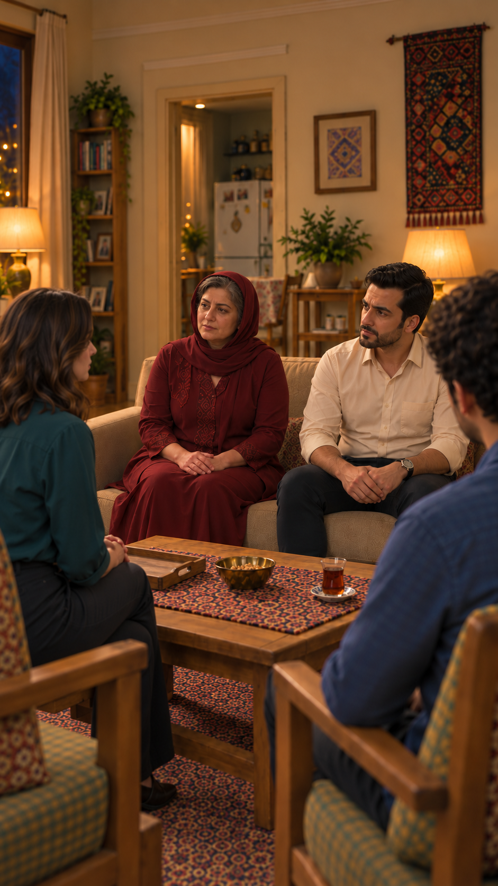
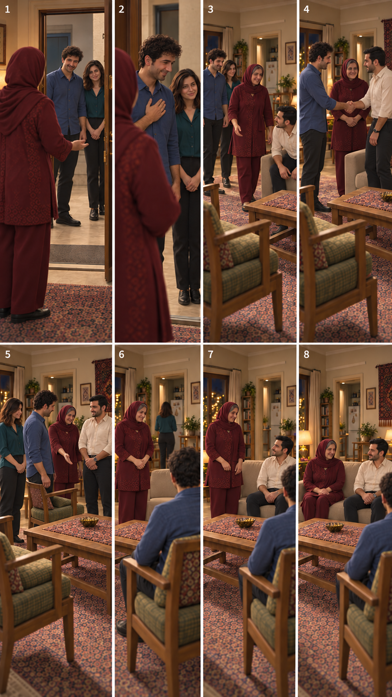

# مقایسهٔ تصویری مکان گفتگوی خصوصی

تاریخ۲۰۲۶/۱۰/۱۴؛ عکس‌های موجود نمایش داده شده‌اند، نه تصویر تازهٔ ساخته‌شده. کاربر فعلاً آشپزخانه را بهتر می‌داند؛ مکان مصوب همچنان آشپزخانه است. پیشنهاد پاگرد برای مقایسه باقی است و تغییر مکان اعمال نشده.

## آشپزخانهٔ باز، پشت کاناپه

دهانهٔ آشپزخانه پشت و نزدیک نشیمن مادر دیده می‌شود؛ درِ بسته‌ای میان جمع و آشپزخانه وجود ندارد. قاب فقط بخشی از عمق را نشان می‌دهد و برای فاصلهٔ عددی یا بررسی اینکه دو نفر در عمق دقیقاً کجا می‌ایستند کافی نیست. مزیت روایی: مسیر کوتاه‌تر و کنش طبیعی‌ترِ کنارکشیدن سامان؛ ضعف: حریم گفتار بدون مانع فیزیکی هنوز قانع‌کننده نشده است.

## پاگردِ بیرونِ خانه؛ قاب‌های۱و۲ صفحه

دو قاب اول در بالای چپ صفحه، سامان و نازلی را بیرونِ در خانه نشان می‌دهند؛ این همان پاگرد معرفی‌شده است. قاب‌های بعدی داخل پذیرایی‌اند و نباید به‌عنوان ادامهٔ طول پاگرد خوانده شوند. پاگرد با راهروی داخل خانه یکی نیست. با بستن درِ موجود، یک مرز فیزیکی میان دو نفر و جمع به وجود می‌آید؛ فاصلهٔ بیشتر و عایق‌بودن در از این صفحه اندازه‌گیری یا اثبات نمی‌شوند.

## نتیجهٔ مقایسه

این دو تصویر از دو زاویه و مقیاس متفاوت‌اند؛ اعلام اینکه یکی چند متر دورتر است معتبر نیست. برای انتخاب صحنه، آشپزخانه ساده‌تر و نزدیک‌تر به طرح مصوب است؛ پاگرد تغییر مسیر/پس‌زمینه و کنترل حرکت در را لازم می‌کند، ولی درِ بسته دلیل روشن‌تری برای حریم گفتگو می‌دهد. تا تصمیم تازه، آشپزخانه حفظ می‌شود و مسئلهٔ خصوصی‌بودن باز است؛ صدای پوشاننده، کار تازهٔ مادر/فرهاد یا دیالوگ تازه بدون مرور اضافه نمی‌شود.

[پیشنهاد دقیق پاگرد و تغییرهای لازم](../privacy-proposal.md) · [طرح مصوب موجود](../production-plan-v1.md). با کلیک هر عکس، فایل کامل و اصلی قابل‌دیدن است؛ هیچ برش، تغییر چهره یا تولید تازه انجام نشده.

## نتیجهٔ انتخاب — ۲۰۲۶/۱۰/۱۵

کاربر پس از مقایسه، آشپزخانه را با فرض آرام و کم‌حجم حرف‌زدن هر دو انتخاب کرد؛ مکان دیگری طراحی نشود. این صفحه سابقهٔ مقایسه است و دیگر درخواست انتخاب باز ندارد.
