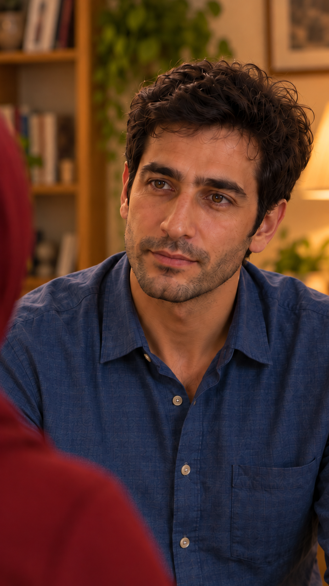

# بازبینی مستقل قاب آغاز — نسخهٔ۲

شناسه: `EP04-SH01`؛ تاریخ۲۰۲۶/۱۰/۱۵؛ مرجع ظاهر `appearance-v1`. وضعیت: **تصویر ثابت ساخته و بازبینی شد؛ قاب ثابت با ادامهٔ کاربر پذیرفته شد**. ابزار داخلی `imagegen`، دو فراخوانی: ساخت نخست و یک اصلاح محدود کادر. هیچ ارسال/تولید `Flow`، مصرف اعتبار آن یا فراخوانی مسیرِ خارجیِ اعتبارسوز انجام نشد. ابزار داخلی قیمت جداگانه‌ای گزارش نکرد؛ هزینهٔ پولی ساختگی ثبت نشده است. تولید ویدیو همچنان بدون مجوز بستهٔ هزینه است.

فایل اصلی خروجی به پوشهٔ مالک نما کپی شد، بدون ویرایش پیکسلی خارج ابزار؛ ابعاد واقعی 941×1672، نسبت نزدیک۹به۱۶. [درخواست نخست](frame-request.txt)، [اصلاح محدودِ کادر](images/EP04-SH01-start-v2-prompt.txt) و [اثر انگشت، ورودی‌ها و سابقهٔ اجرا](frame-inputs.json) محفوظ‌اند. نسخهٔ نخست کادر باز، ساعد و بخش صندلی داشت؛ در ابزار با حفظ هویت/لباس بسته‌تر شد و در پروژه به‌عنوان قاب فعال نگه‌داری نمی‌شود. اصل تولیدهای ابزار حذف نشده‌اند؛ آرشیو پروژه ساخته نشد.

## منابع مشاهده و حدود

خروجی نخست و اصلاح‌شده دیده شدند؛ مقایسهٔ بصری با [پرترهٔ هویت سامان](../../../episode-02/references/01-saman-portrait-v1.png)، [پیراهن و حالتِ پذیرفتهٔ قسمت۳](../../../episode-03/shots/EP03-SH10/images/EP03-SH10-intent-v4.png)، [جمعِ پذیرفته‌شده](../../../episode-03/shots/EP03-SH07/images/EP03-SH07-seated-after-tea-v3.png) و [هویت خانواده](../../../episode-01/references/01-casting-and-living-room-concept-v1.png) انجام شد. این مشاهدهٔ ثابت است؛ ثبات ویدیو، حرکت چشم/لب یا صدا بررسی نشده‌اند. جزئیات ژرفای خانه و آخرین قاب ویدیوییِ قسمت۳ از همین تصویر اثبات نمی‌شوند.

## سامان — بررسی مستقل

| مورد | نتیجه | شاهد و محدودیت |
|---|---|---|
| صورت، چشم/ابرو، بینی، لب، فک و سن ظاهری | بررسی شد و قبول در حد تصویر ثابت | هویت قابل‌شناسایی با پرتره و عکس پیراهن مصوب سازگار؛ تغییر آشکار شخصیت مشاهده نشد. این نتیجه تضمین شباهت همهٔ فریم‌های آینده نیست. |
| مو و ته‌ریش | بررسی شد و قبول در حد تصویر ثابت | مو تیره و موج‌دار با خط رویش و حجم نزدیک مرجع؛ ته‌ریش کوتاه و پیوسته. مقیاس نمای نزدیک جزئیات را بیشتر نشان می‌دهد، نه مرجع هویت تازه. |
| پیراهن | بررسی شد و قبول در بخش قابل‌دیدن | آبیِ یقه‌دار دکمه‌دار با جنس/نقش مرجع؛ تی‌شرت مرجع هویت منتقل نشده است. بخش زیر کادر و شلوار دیده نمی‌شوند. |
| دست و ساعد | نامرتبط با دلیل در تصویر فعلی | هر دو بیرون کادرند؛ روی ران بودنِ واقعی در ادامهٔ ویدیو باید جدا کنترل شود. دست ساختگی داخل قاب وجود ندارد. |
| نگاه و حالت شروع | بررسی شد در حد تصویر ثابت | نگاه به سمت محل مادر در چپ، لب بسته و حالت محترمِ آرام؛ استمرار نگاه به چشم واقعی مادر و تکان سر باید در ویدیو بررسی شوند. |

## مادر نازلی — بررسی مستقل

| مورد | نتیجه | شاهد و محدودیت |
|---|---|---|
| صورت و اجزای هویت | نامرتبط با دلیل | فقط پشت سر/روسری و شانه در چپ دیده می‌شود؛ این قاب تأیید روبه‌روی صورت مادر نیست. |
| روسری و لباس قابل‌دیدن | بررسی شد و قبول در حد بخش قابل‌دیدن | زرشکیِ مرجع؛ صورت و جلوی پیشانی/لایهٔ احتمالیِ پنهان دیده نمی‌شوند و قبولیِ آن جزئیات از این قاب استنتاج نشد. |
| صاحب شانه و موقعیت | بررسی شد در حد طرح/تصویر ثابت | پیش‌زمینهٔ چپ متعلق به مادرِ مقابل سامان است؛ دهان او دیده نمی‌شود. خود نشیمن/کاناپه خارج قاب است و جای دقیق بدن در حرکت جدا کنترل شود. |

نازلی و فرهاد: نامرتبط با دلیل، کامل خارج کادر طبق طرح؛ تکهٔ سبزآبی یا چهرهٔ اضافی داخل خروجی اصلاح‌شده دیده نشد.

## قاب، محیط و آمادگی

- کادر بسته‌تر از نخست و نزدیک به اندازهٔ مصوب: سر و بالای تنه، بدون دست/ساعد، میز، استکان، نعلبکی، صندلی و دستهٔ چوبی. شانهٔ مادر محو و صورت سامان واضح است؛ متن یا شماره روی تصویر نیست.
- نور و رنگ در امتداد مرجع پیراهن و شبِ قسمت۳؛ تغییر واضح نور روز یا وسیلهٔ تازه مشاهده نشد. پس‌زمینه از مرجع موجود مشتق و کم‌توجه است؛ تطبیق هندسهٔ تمام نمای معکوسِ خانه و اتصال آخرین ویدیوی۳ هنوز بررسی نشده. برای تولید حرکت، این محدودیت باید در بستهٔ همان برداشت مشخص بماند.
- گفتار، لب‌خوانی و حرکت: بررسی نشده، تصویر ثابت است. مرجع صوتی مصوب سامان تغییر نکرده؛ هیچ صدا تولید نشده.
- پذیرش همین تصویر ثابت با ادامهٔ کاربر ثبت شد؛ این پذیرش مجوز تولید ویدیو، تأیید صدا/حرکت یا بسته‌شدن محدودیت‌های مشاهده نیست. قدم بعد: مرور همین قاب؛ سپس قاب۲ و تهیهٔ گزارش همان نما، بدون تعمیم قبولیِ قاب۱ به سایر نماها.

پذیرش ثبت‌شده۲۰۲۶/۱۰/۱۵: کاربر پس از نمایش قاب۱، ادامه به مرحلهٔ بعد را خواست؛ مرحلهٔ قاب۲ اعلام شد و کاربر گفت «قدم بعدی».
