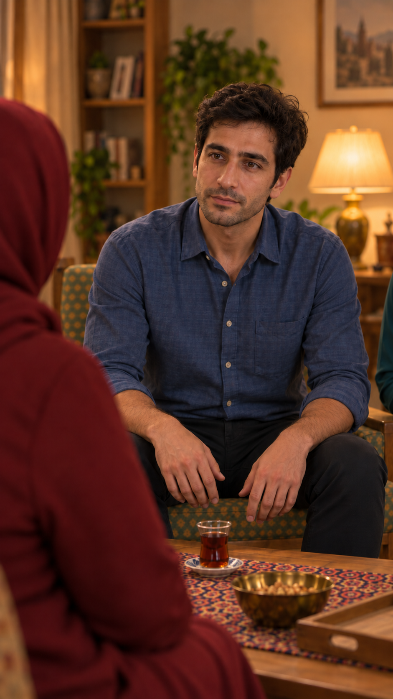

# قاب آغاز قسمت چهار — آماده‌سازی نمای۱

تاریخ۲۰۲۶/۱۰/۱۵. وضعیت تازه: **بسته با موافقت کاربر در ابزار داخلی اجرا شد؛ قاب نسخهٔ۲ برای مرور ساخته شده**. [قاب و گزارش خروجی](appearance-review-v2.md) مرجع وضعیت تازه‌اند؛ بررسی‌های آماده‌سازیِ زیر سابقهٔ پیش از اجرا هستند. هیچ ارسال یا اعتبار `Flow` مصرف نشد؛ قیمت پولیِ ابزار داخلی گزارش نشده. انتخاب طرح با پذیرش تصویر خروجی و اجازهٔ هزینه فرق دارد.

## استفاده از موجود قبل از تولید تازه

این منبع از نظر هویت، پیراهن آبی، نشستن و جای شانهٔ مادر به نما نزدیک است. استفادهٔ مستقیم از تمام تصویر برای قاب مصوب۱ کافی نیست: کادر تا دست‌ها و میز پایین آمده، مدل نعلبکی در گزارش قبلی ایراد باز دارد و تکهٔ سبزآبی در لبهٔ راست دیده می‌شود؛ نازلی در طرح نمای۱ خارج کادر است. زمینهٔ معکوس نیز نباید بدون تطبیق به هندسهٔ تازه تعمیم داده شود. پس منبع مرجع است، نه قاب نهایی پذیرفته‌شده.

## قاب دقیق موردنیاز

همان سامان و پیراهن، متوسط نزدیک از میانهٔ سینه تا سر، شانه و پشت سر مادر پایین چپ، نازلی/فرهاد و میز/نعلبکی خارج کادر؛ نگاه به چشم مادر، دوربین ثابت در ارتفاع چشم سامان. این اندازه از قبل در کارت نما مصوب است؛ برای دورزدن خطای محتوا، اشیای داخل صحنه حذف یا جابه‌جا نمی‌شوند.

[متن کامل درخواست تصویر](frame-request.txt) در همین پوشه آماده است؛ زبان فارسی و بدون دیالوگِ خواندنی یا نوشته روی تصویر. این درخواست در ابزار داخلی اجرا شد؛ سپس کادر با اصلاح محدود بسته‌تر شد.

## ورودی‌های دقیق و نقش‌ها

| مرجع | تصویر واقعی | نقش و محدودیت |
|---|---|---|
| مرجع هویت سامان | [دیدن ورودی](../../../episode-02/references/01-saman-portrait-v1.png) | فقط چهره/مو/ته‌ریش؛ تی‌شرت ممنوع |
| مرجع لباس و حالت سامان | [دیدن ورودی](../../../episode-03/shots/EP03-SH10/images/EP03-SH10-intent-v4.png) | صورت/پیراهن/نشستن؛ نعلبکی و پس‌زمینه مالک محیط نیستند |
| مرجع محیط و لباس مادر | [دیدن ورودی](../../../episode-03/shots/EP03-SH07/images/EP03-SH07-seated-after-tea-v3.png) | جای نشستن، محیط و روسری/لباس مصوب |
| مرجع هویت مادر | [دیدن ورودی](../../../episode-01/references/01-casting-and-living-room-concept-v1.png) | فقط پنل بالای وسط؛ پوشش قدیمی منتقل نشود |

## بررسی آماده‌سازی و محدودیت

| مورد | نتیجه | شاهد |
|---|---|---|
| استفاده از منبع موجود | بررسی شد؛ نقش مرجع قابل‌استفاده، استفادهٔ مستقیم کامل مناسب نیست | مشاهدهٔ تصویر بالا؛ کادر، نعلبکی و لبهٔ سبزآبی؛ هیچ اصلاحی انجام نشده. |
| حفظ هویت و لباس | مرجع مصوب مشخص؛ خروجی تازه بررسی نشده | ورودی‌ها و نقش‌های جدول؛ تصویر تازه نداریم. |
| قاب، گوینده و شانهٔ مادر | در سطح طرح بررسی شد؛ خروجی بررسی نشده | [کارت مالک](shot.md)؛ فقط سامان و پشت سر مادر. |
| نگاه، هندسه و اجزای قابل‌دیدن | قید طرح مشخص؛ خروجی بررسی نشده | تصویر باید با قاب جمع و سمت دوربین کنترل شود؛ زمینهٔ منبع صرفاً کپی نشود. |
| صدا و لب‌خوانیِ تصویر ثابت | نامرتبط با دلیل | درخواست فقط عکسِ پیش از گفتار است؛ صدا تولید نمی‌شود. مرجع صدای سامان برای مرحلهٔ ویدیو محفوظ است. |
| هزینه، ابزار و تنظیمات زنده | تعیین/تأیید نشده | تعداد پیشنهادی یک تصویر، عمودی۹به۱۶؛ ابزار، وضوح واقعی و هزینه هنوز مجوز ارسال ندارند. |

قدم بعد: مرور همین قاب و درخواستِ دقیق؛ پیش از هر اقدام اعتبارسوز، هزینهٔ همان یک اقدام و سقف روشن اعلام و تأیید صریح گرفته شود. اگر هنوز ایراد ورودی/طرح قابل‌تشخیص باز باشد، ارسال انجام نشود. این فایل گزارش بررسی خروجی یا مجوز ارسال نیست.
