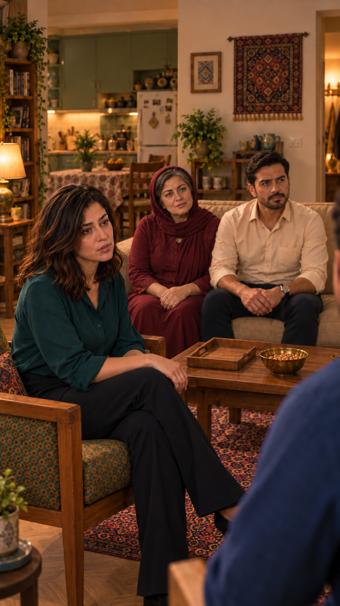

# بازبینی بازسازی نمای02، نسخهٔ3

وضعیت: بازسازی‌شده بر اساس خانهٔ منتخب کاربر، در انتظار مرور و پذیرش همین خروجی. مرجع ظاهر `appearance-v1`.

[ورودی‌ها و پرامپت‌های دقیق](frame-inputs.json) · [خانه از بالا](../../../../house/apartment-cutaway-v2.png)

ایستگاه دوربین: جنوب‌غرب/غرب میز، به سمت شمال‌شرق؛ زاویهٔ چندلایه برای نازلی و کاناپه.

جای افراد: نازلی جلو چپ، مادر و فرهاد روی کاناپه در عمق، شانه سامان پایین راست.

بررسی هندسه — بررسی شد و قبول برای سمت کلی فضاها: کانـاپه و آشپزخانه و راهروی راست در سمت کلی نقشه‌اند؛ حذف ناخواستهٔ مادر در خروجی اولیه اصلاح شد.

بررسی مستقل ظاهر و بدن: نازلی: صورت و مو و لباس سبزآبی و پای روی پا تطبیق داده شد؛ تغییر آشکار هویت دیده نشد. فرهاد: صورت/مو/ریش و پیراهن کرم و ساعت چپ با ورودی مقایسه شد؛ مادر: صورت/موی جلوی سر/روسری تک‌لایه و تونیک زرشکی با مرجع مادر مقایسه شد؛ تغییر آشکار دیده نشد. صورت سامان پوشیده است؛ فقط شانه و موی پشت سر قابل‌تطبیق‌اند. محل دقیق لنز و تمام پایه‌های صندلی‌ها دیده نمی‌شود؛ برابری متری فاصله اثبات نشده است.

بررسی نشده: اندازه‌گیری دقیق زاویه و فاصله و تمام مختصات مبلمان، تمام بخش‌های پوشیده، ثبات در حرکت، مسیر کامل بدن، صدا و لب‌خوانی. تصویر مولد، اثبات مدل سه‌بعدی دقیق نیست. عدم اندازه‌گیری به‌عنوان تأیید۹۰درجه یا۷۰سانتی‌متر ثبت نشده است. اشیای قابل‌دیدن سینی خالی، کاسه و استکان با سمت دوربین تطبیق داده شدند؛ اشیای خارج برش قابل‌ارزیابی نیستند. متن و جهت بازی مصوب تغییر نکرده‌اند. بدون ویدیو و صوت تازه؛ مجوز ارسال همچنان خالی است.
