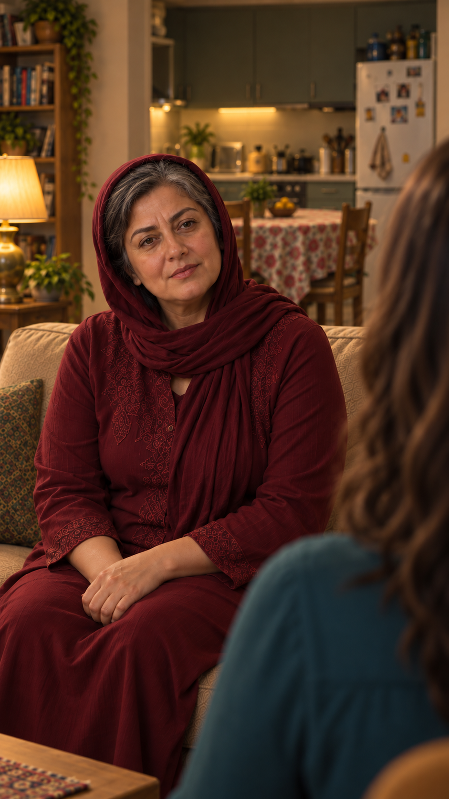

# بازبینی بازسازی نمای03، نسخهٔ2

وضعیت: بازسازی‌شده بر اساس خانهٔ منتخب کاربر، در انتظار مرور و پذیرش همین خروجی. مرجع ظاهر `appearance-v1`.

[ورودی‌ها و پرامپت‌های دقیق](frame-inputs.json) · [خانه از بالا](../../../../house/apartment-cutaway-v2.png)

ایستگاه دوربین: کنار نازلی در جنوب‌غرب کاناپه، رو به مادر و شمال‌شرق.

جای افراد: مادر مرکز/چپ، موی نازلی پیش‌زمینه راست؛ فرهاد و سامان خارج برش.

بررسی هندسه — بررسی شد و قبول برای سمت کلی فضاها: آشپزخانه با کابینت و یخچال و میز غذاخوری پشت مادر است؛ جای کلی کاناپه حفظ شد.

بررسی مستقل ظاهر و بدن: مادر: چهره/مو/روسری واحد/تونیک زرشکی و دست‌های روی پا با ورودی مقایسه شد؛ تغییر آشکار دیده نشد. نازلی پشت مو و شانه سبزآبی دارد؛ صورت او دیده نمی‌شود. بقیه افراد خارج قاب‌اند؛ فاصلهٔ صندلی‌ها از قاب نزدیک اثبات نمی‌شود.

بررسی نشده: اندازه‌گیری دقیق زاویه و فاصله و تمام مختصات مبلمان، تمام بخش‌های پوشیده، ثبات در حرکت، مسیر کامل بدن، صدا و لب‌خوانی. تصویر مولد، اثبات مدل سه‌بعدی دقیق نیست. عدم اندازه‌گیری به‌عنوان تأیید۹۰درجه یا۷۰سانتی‌متر ثبت نشده است. اشیای قابل‌دیدن سینی خالی، کاسه و استکان با سمت دوربین تطبیق داده شدند؛ اشیای خارج برش قابل‌ارزیابی نیستند. متن و جهت بازی مصوب تغییر نکرده‌اند. بدون ویدیو و صوت تازه؛ مجوز ارسال همچنان خالی است.
