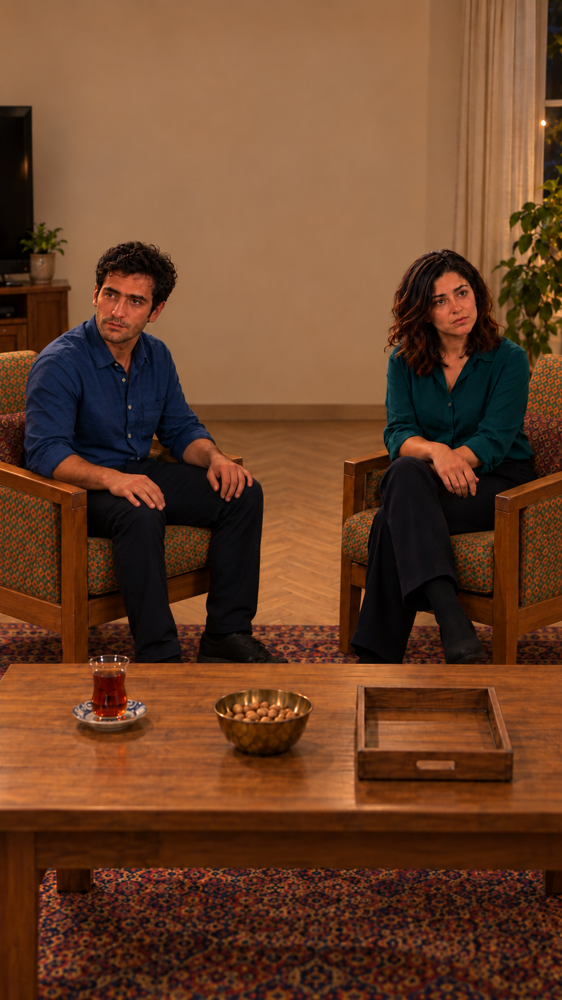

# بازبینی بازسازی نمای04، نسخهٔ4

وضعیت: بازسازی‌شده بر اساس خانهٔ منتخب کاربر، در انتظار مرور و پذیرش همین خروجی. مرجع ظاهر `appearance-v1`.

[ورودی‌ها و پرامپت‌های دقیق](frame-inputs.json) · [خانه از بالا](../../../../house/apartment-cutaway-v2.png)

ایستگاه دوربین: شمال میز، نزدیک کاناپه، رو به جنوب؛ زاویهٔ مقابل نمای جمع.

جای افراد: سامان چپ تصویر، نازلی راست؛ تغییر سمت تصویری بر اثر دوربین مقابل است. هر دو نشسته.

بررسی هندسه — بررسی شد و قبول برای سمت کلی فضاها: آشپزخانه پشت دوربین و خارج قاب است؛ تلویزیون شرق در چپ تصویر و پنجره غرب در راست تصویر قرار می‌گیرد. تزئینات شمالی که ابزار اشتباهاً روی دیوار جنوب ساخته بود حذف شدند.

بررسی مستقل ظاهر و بدن: نازلی و سامان: صورت، مو، ته‌ریش سامان، پیراهن‌ها و شلوارها با ورودی مقایسه شدند؛ تغییر آشکار دیده نشد. نازلی پای روی پا و دست روی پای خودش دارد؛ پای روی پای ناخواسته سامان اصلاح و دو پای او روی زمین شد. هر دو صندلی به داخل مایل‌اند؛ زاویه۹۰درجه و فاصله۷۰سانتی‌متر از این عکس اندازه‌گیری نشده‌اند. مادر و فرهاد پشت دوربین‌اند و صورتشان نامرتبط است.

بررسی نشده: اندازه‌گیری دقیق زاویه و فاصله و تمام مختصات مبلمان، تمام بخش‌های پوشیده، ثبات در حرکت، مسیر کامل بدن، صدا و لب‌خوانی. تصویر مولد، اثبات مدل سه‌بعدی دقیق نیست. عدم اندازه‌گیری به‌عنوان تأیید۹۰درجه یا۷۰سانتی‌متر ثبت نشده است. اشیای قابل‌دیدن سینی خالی، کاسه و استکان با سمت دوربین تطبیق داده شدند؛ اشیای خارج برش قابل‌ارزیابی نیستند. متن و جهت بازی مصوب تغییر نکرده‌اند. بدون ویدیو و صوت تازه؛ مجوز ارسال همچنان خالی است.
