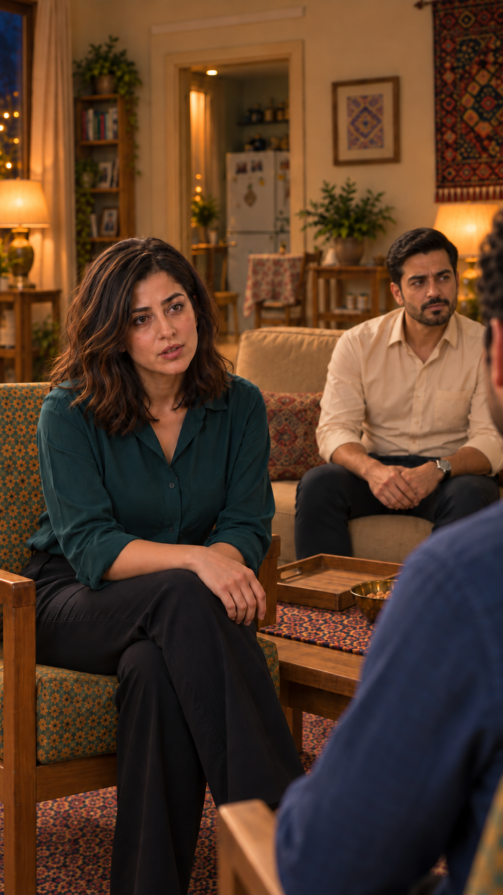
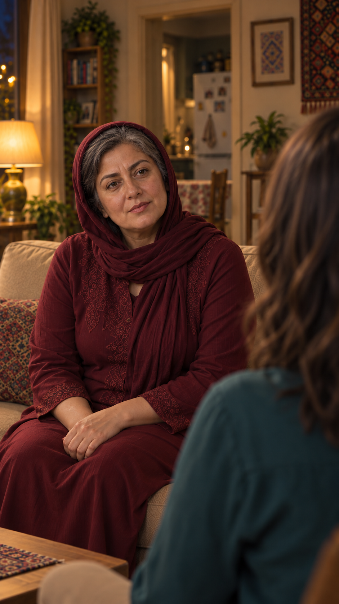
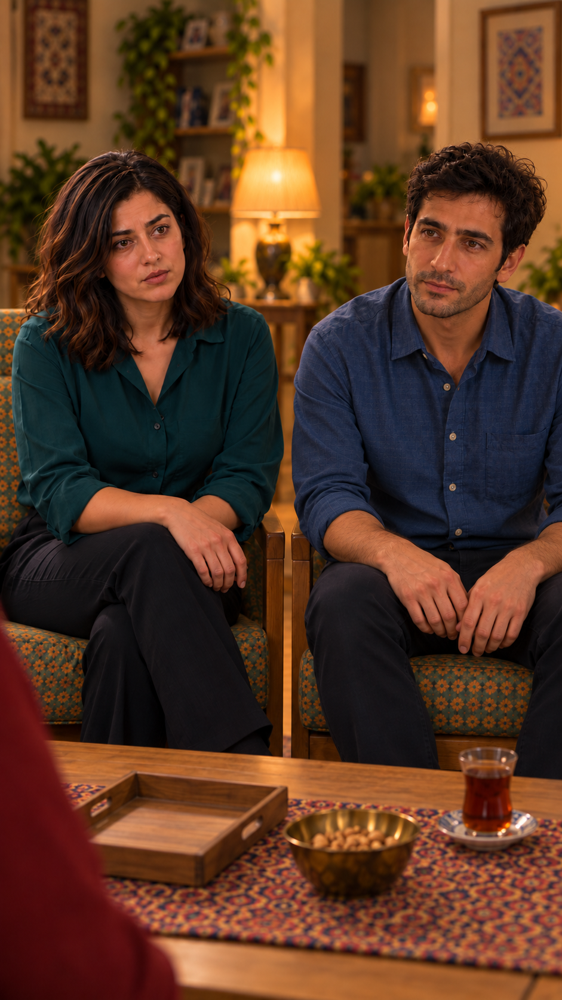
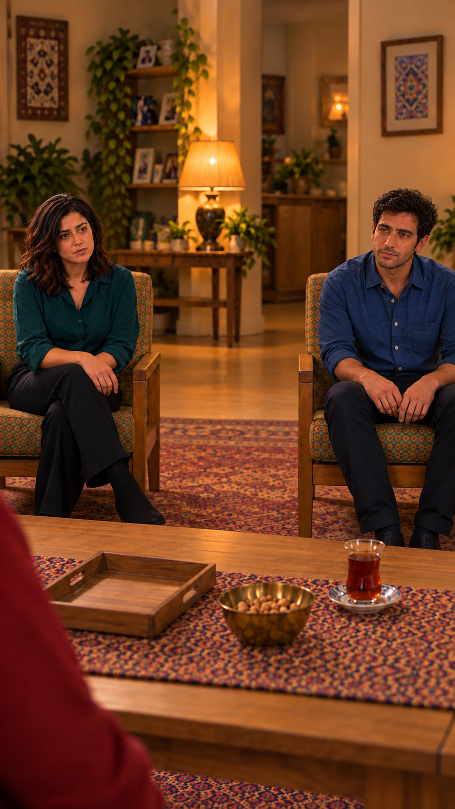
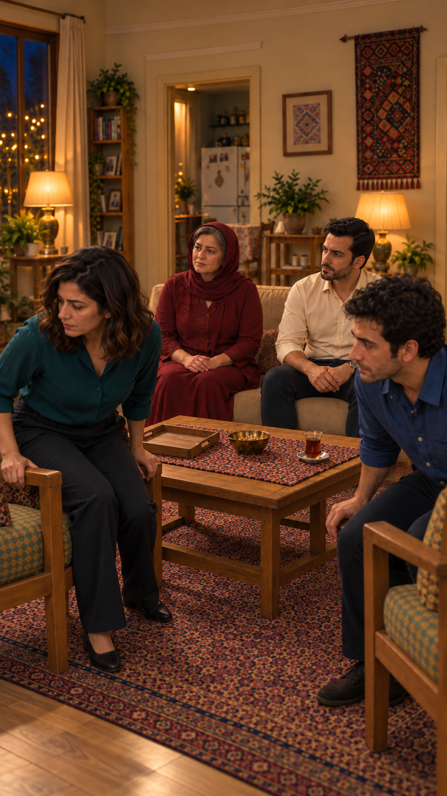
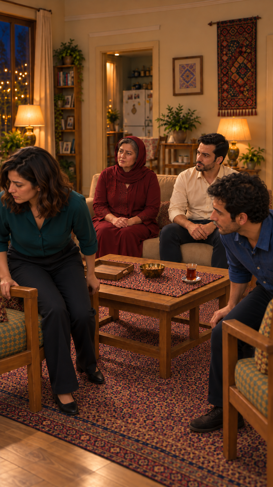

> سابقهٔ آماده‌سازی/بررسی؛ وضعیت جاری در [کارت قسمت](episode.md) و [بستهٔ منتشرشده](publishing/manifest.json) است. این سند مجوز ارسال تازه نیست.

# بازبینی دوبارهٔ هندسهٔ قاب‌های قسمت۴

تاریخ۲۰۲۶/۱۰/۱۵. دامنه: همهٔ۷تصویر ذخیره‌شدهٔ شروع نماهای۱،۲،۳،۴و۱۳. هر هفت فایل در این نوبت واقعاً دیده شدند. این بررسی شامل کل تصاویر قسمت۳ یا ویدیوها نیست؛ از قسمت۳ قاب جمع نمای۷ و تصویر اولیهٔ خانه برای مقایسه دیده شدند. تصویر خانه از بالا هنوز پیشنهادی است؛ نتیجه بر رابطهٔ قطعی آشپزخانه/کاناپه و قید صریح۹۰درجهٔ کاربر تکیه دارد، نه اعتبار خودکار تصویر تازه.

## قاب۱، نسخه۲

**بررسی نشده برای هندسهٔ کامل** — قاب بسیار بسته است؛ مادر پیش‌زمینه و سامان دیده می‌شوند ولی صندلی و فاصله و نقشه کامل معلوم نیست. چراغ و کتابخانه پس‌زمینه نیازمند تعیین دقیق دوربین‌اند. برای حفظ چهره مفید است؛ مجوز هندسی ندارد.

## قاب۲، نسخه۲

**ایراد باز** — نازلی تقریباً روبه‌لنز، فرهاد روی کاناپه و آشپزخانه پشت هر دو دیده می‌شوند؛ جهت صندلی نازلی نسبت به چیدمان قائم ثابت نشده و با جای مایلِ پیشنهادی سازگار نشان داده نشده است. نیازمند بازسازی پس از قفل نقشه.

## قاب۳، نسخه۱

**بررسی شد و قبول فقط برای رابطهٔ محدود** — مادر روی کاناپه و آشپزخانه پشت او از نظر سمت کلی سازگارند. فاصله و جای دقیق صندلی نازلی از شانهٔ محو معلوم نیست؛ پذیرش کامل هندسه نداریم.

## قاب۴، نسخه۱

**ایراد باز؛ مردود** — دو صندلی چسبیده و موازی‌اند؛ چیدمان تاریخی حفظ نشده.

## قاب۴، نسخه۳

**ایراد باز؛ مردود** — فاصله بیشتر شده ولی صندلی‌ها همچنان تقریباً موازی‌اند؛ اصلاح فاصله مشکل زاویه را رفع نکرده.

## قابخروج، نسخه۱

**ایراد باز؛ مردود** — جوان‌ها برای خوانایی صورت رو به دوربین چرخیده‌اند و جهت ثابت صندلی‌ها از مرجع جمع حفظ نشده است.

## قابخروج، نسخه۲

**ایراد باز؛ مردود** — کانـاپه و آشپزخانه سمت کلی درست دارند ولی جهت صندلی و بدن جوان‌ها با زاویهٔ ثابت موردنظر سازگار نیست.

اصلاح‌های آزمایشی زاویه که فقط در گفت‌وگو نمایش داده شدند و وارد پوشهٔ قسمت نشده‌اند هم با نشان‌دادن آشپزخانه پشت جوان‌ها مردودند. هیچ‌کدام مرجع تازه نشدند. همهٔ قاب‌های دیگر هنوز ساخته نشده‌اند. تأیید قبلی ظاهر کاربر حفظ می‌شود ولی به تأیید هندسی تعمیم ندارد. پیش از بازسازی، تصویر خانه و نقشه باید تثبیت و ایستگاه دوربین هر نما روی نقشه مشخص شوند.
