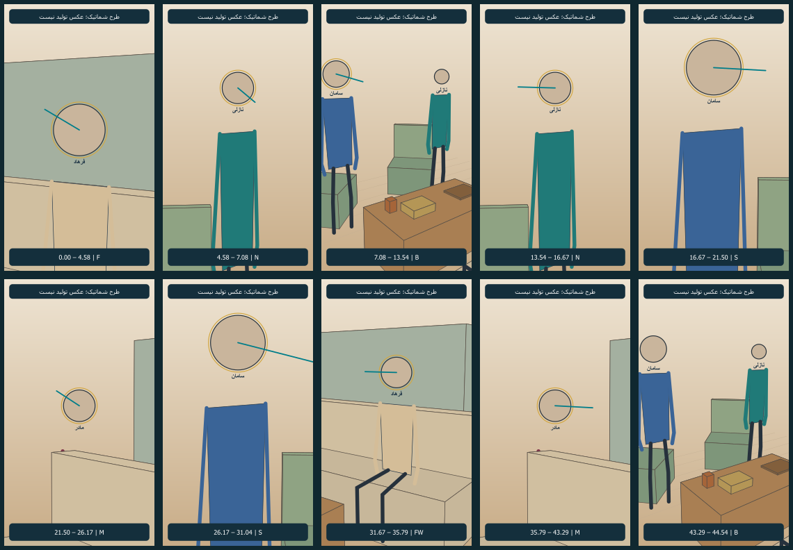

# طرح نماهای قسمت پنج؛ نسخهٔ۱

وضعیت: پیشنهادی؛ طرح شماتیک و دوربین آمادهٔ مرور است، عکس تولیدی تازه و ویدیو ساخته نشده‌اند. اعتبار مصرف نشده است.

[مرور یک‌جای تصویری و جزئیات](storyboard.html) · [پلان دوربین](references/camera-plan-v1.svg) · [زمان‌بندی مبنا](timing-plan.md)

تصویر بالا طرح رنگی جای بدن و قاب است؛ صورت، مو و روسری ندارد و مرجع هویت نیست. تصاویر واقعی خانه و شخصیت‌ها در صفحهٔ مرور یکجا کنار طرح آمده‌اند.

## تصمیم‌های طراحی

- زمان هدف۴۴٫۵۴۲ثانیه؛ سؤال آغاز یک بار، عنوان دوثانیه روی نخستین تصویر زمان حال، خندهٔ۰٫۶۲۵ثانیه در همان دنبالهٔ جواب سامان، واکنش پایانی۱٫۲۵ثانیه.
- جوان‌ها تمام بدنه ایستاده‌اند؛ مادر و فرهاد روی کاناپه. صندلی‌ها خالی و با زاویه۹۰درجه ثابت‌اند؛ هیچ نشستن دوباره یا جابه‌جایی برای دوربین افزوده نشده.
- تمام نماها در خانه و زمان حال‌اند. خاطرهٔ ساندویچی با گفتار روایت می‌شود؛ بازگشت تصویری تازه، لباس گذشته و مکان تازه طراحی نشده‌اند.
- برای نشان‌دادن توجه و طنز، تنوع اندازه و جهت نگاه کافی است؛ فقط نمای توضیح تندی غذا پیشروی بسیار کوتاه پیشنهادی دارد.
- فرهاد هنگام خداحافظی شروع بلندشدن، در بدرقه از کنار شرقی میز به راهرو می‌رود. در و هندسهٔ ناشناخته‌اش وارد قاب نمی‌شوند. مسیر کامل خروج هنوز اجرا و بازبینی نشده است.

## نماها

| بازه؛ ثانیه | مالک نما | اندازه و دوربین | هدف و اتصال |
|---|---|---|---|
| 0.000–4.583 | [EP05-SH02](shots/EP05-SH02/shot.md) | نزدیک فرهاد | فرهاد نشسته، نگاه بالا به سامان ایستاده؛ هیچ پاسخ دختر در این بازپخش نباشد. |
| 4.583–7.083 | [EP05-SH03](shots/EP05-SH03/shot.md) | نزدیک نازلی | نازلی ایستاده؛ پاسخ کوتاه رو به فرهاد، سپس نگاه کوتاه به سامان؛ دست‌ها پایین. |
| 7.083–13.542 | [EP05-SH05](shots/EP05-SH05/shot.md) | دونفرهٔ ایستاده و بازتر | سامان چپ تصویر و نازلی راست؛ هر دو جلوی صندلی خود ایستاده؛ سامان از فرهاد به مادر و نازلی نگاه می‌برد. |
| 13.542–16.667 | [EP05-SH06](shots/EP05-SH06/shot.md) | نزدیک نازلی | نازلی شوخی را به سامان می‌گوید؛ فقط سر و چشم به او بچرخد، پا و صندلی ثابت. |
| 16.667–21.500 | [EP05-SH07](shots/EP05-SH07/shot.md) | متوسط نزدیک سامان | سامان با خجالت مختصر جواب می‌دهد؛ دست به دهان نمی‌برد، آب یا ساندویچ در زمان حال ظاهر نمی‌شود. |
| 21.500–26.167 | [EP05-SH08](shots/EP05-SH08/shot.md) | متوسط نزدیک مادر | مادر نشسته، نگاه بالا به چشم سامان؛ دست‌های خودش روی پا، روسری تک‌لایه و بدون حرکت نمایشی. |
| 26.167–31.042 | [EP05-SH10](shots/EP05-SH10/shot.md) | متوسط نزدیک سامان | سامان مؤدبانه رو به مادر؛ پایان جمله لب‌ها بسته و لبخند کوتاه؛ سپس خندهٔ مادر و نازلی خارج قاب در همان دنباله. |
| 31.667–35.792 | [EP05-SH14](shots/EP05-SH14/shot.md) | متوسط فرهاد با فضای آغاز بلندشدن | فرهاد ابتدا نشسته؛ نگاه به مادر و جمع؛ در پایان به جلو متمایل و شروع به بلندشدن می‌کند، بدون اخم. خروج کامل در این نما الزام ندارد. |
| 35.792–43.292 | [EP05-SH15](shots/EP05-SH15/shot.md) | متوسط نزدیک مادر | مادر اول به فرهاد در حال بلندشدن، سپس به سامان نگاه کند. فرهاد از کنارهٔ شرقی میز به سمت راهرو برود؛ گذر از وسط میز و نشان‌دادن در ممنوع. |
| 43.292–44.542 | [EP05-SH15-END](shots/EP05-SH15/shot.md) | دونفرهٔ ایستاده و بازتر | نازلی سمت راست تصویر نگاه را به سامانِ چپ می‌برد؛ سامان نگاه او را می‌بیند. صندلی‌ها خالی و ثابت‌اند؛ دست‌ها پایین و هیچ نشستن مجددی نیست. |

## تطبیق ظاهر و مرجع‌ها

صورت نازلی و مادر و فرهاد از تصویر مصوب قسمت۱و صورت سامان از پرترهٔ قسمت۲است. لباس دیدار همان روزاول: نازلی بلوز دکمه‌دار سبزآبی و شلوار تیره، سامان پیراهن آبی یقه‌دار و شلوار تیره، فرهاد پیراهن کرم و شلوار تیره، مادر تونیک و شلوار زرشکی و فقط یک روسری زرشکی با موی واقعی نمایان. لباس تی‌شرت پرتره سامان به دیدار منتقل نشود؛ پارچه و حالت دقیق آستین از قاب معتبر همان دیدار کنترل شوند.

قاب تاریخی مادر با شانهٔ نشستهٔ نازلی برای قسمت۵قاب فعال نیست، چون نازلی اکنون ایستاده است. قاب تاریخی دونفره فقط شاهد شروع ایستاده و رنگ لباس است؛ خطای فاصله یا هویت اگر در عکس آینده دیده شد، پذیرش تاریخی توجیه آن نیست.

هر نما [گزارش مستقل طراحی](shots/EP05-SH03/design-review-v1.md) دارد؛ لینک همان گزارش در کارت مالک خودش است. قبول هندسهٔ مدل به معنی قبول چهره یا حرکت تولیدنشده نیست.

## کنترل انجام‌شده و کارهای باز

خانه، مرجع چهره‌ها، پرتره سامان و سه قاب تاریخی واقعاً دیده شدند؛ پس از ساخت، مرور۱۰قابی و پلان جدید واقعاً دیده شدند. برش نامناسب سر سامان در دونفره، جای پا نسبت به نشیمن و جای پشت صندلی در مدل اصلاح شدند. مدل ثابت از همان مختصات برای تمام قاب‌ها استفاده می‌کند؛ این اعداد اندازهٔ خانه نیستند.

صفحهٔ مرور در مرورگر محلی و نمای۱۴۴۰پیکسلی و۳۷۵پیکسلی بررسی شد؛ دکمه‌های باز/بستن جزئیات عمل کردند، خطای صفحه یا سرریز افقی دیده نشد. تصاویر مرجع محلی هستند و فایل‌ها به اینترنت وابسته نیستند.

عکس‌های نهایی چهره‌دار هنوز تهیه نشده؛ تطبیق پوست/مو/ریش/روسری و حالت چشم روی خروجی واقعی، کنترل حرکت و لب‌خوانی و اتصال‌ها، شنیدن ضبط‌ها و سؤال، و گزارش پیش از ارسال کامل هنوز بازند. هیچ موردِ بررسی‌نشده به‌عنوان آمادهٔ تولید معرفی نمی‌شود.
