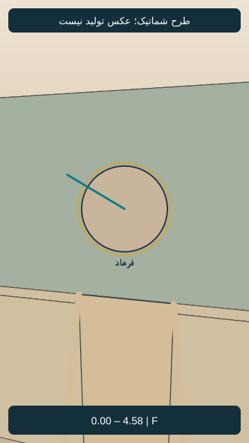
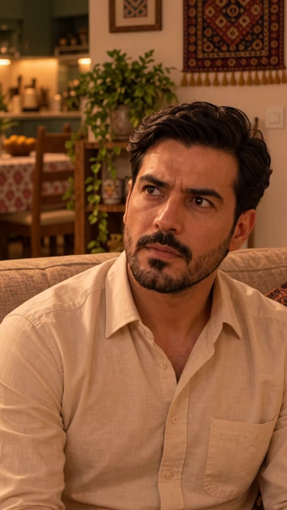

# EP05-SH02

## وضعیت فعلی

نسخهٔ ساندویچی با دعوت مشترک نازلی و مادرش به تأیید صریح کاربر رسید. اجرای واقعی نسخهٔ جدید بررسی نشده؛ هیچ مجوز ارسال تازه یا هزینه وجود ندارد.

<!-- shot-state -->
```json
{
  "shot": "EP05-SH02",
  "active": true,
  "order": 1,
  "selected_take": null,
  "selected_video": null,
  "selected_sha256": null,
  "selection_status": "not_selected",
  "selection_evidence": null,
  "trim": null,
  "active_frame": null,
  "send_request": null
}
```
<!-- /shot-state -->

## متن و دستور اجرا

[پیوستگی قسمت](../../continuity.md) · [قواعد پروژه](../../../../project-rules.md)

<a id="ep05-d02"></a>
### `EP05-D02` — فرهاد
- متن: «سامان، اوّلین قَرارتون کُجا بود؟»
- وضعیت متن: بازنویسی ساندویچی با تأیید صریح کاربر جایگزین شد؛ اجرای واقعی تأیید نشده.
- مالک گفتار: `CH-FAR`؛ مخاطب: سامان؛ گوینده داخل قاب، نوبت روشن و بدون هم‌پوشانی؛ شنونده‌ها ساکت و بدون لب‌خوانی گفتاری.
- دستور اجرا؛ خوانده نشود: مستقیم و کنترل‌شده، برای گرفتن جزئیات؛ نگاه ثابت به سامان.
- وضعیت جهت بازی: پیشنهادی در نسخهٔ پذیرفته‌شده؛ اجرای واقعی هنوز بررسی نشده.

سؤال از پایان قسمت۴بازپخش شود؛ ضبط یا تولید دوباره پیش‌فرض نیست. محدودهٔ برش هنوز تعیین نشده است.

## وضعیت منبع سؤال در برنامهٔ زمان

منبع منتخب تاریخی، نسخهٔ اصلاح‌شدهٔ نمای۱۲قسمت۴با۱۱۰قاب/۴٫۵۸۳۳ثانیه است؛ فایل ویدیویی در این رایانه موجود نیست. [برنامهٔ کامل و شاهد مدت](../../timing-plan.md). این بازه از اسناد است، نه بازبینی زنده؛ بازیابی رسانه پیش از تدوین واقعی لازم است.

## دریافت اصل و نامزد بازسازی

اصل ارسالی با اثرانگشت اصل قسمت۴مطابقت کامل داشت و بازیابی شد. [نامزد مستقل۴٫۵۸۳ثانیه‌ای و گزارش](sources/README.md) موجود است؛ هنوز شنیده یا منتخب نشده. وضعیت فقدان اصل در بند قبلی منسوخ است؛ نسخهٔ منتخب تاریخی همچنان دریافت نشده و نامزد تازه خودکار جای آن ننشسته است.

## طرح قاب و بازی قسمت پنج — نسخهٔ۱، پیشنهادی

[](images/EP05-SH02-blocking-v1.svg)

- زمان پیشنهادی: 0.000 تا 4.583 ثانیه؛ مطابق برنامهٔ زمان، نه زمان خروجی تولیدشده.
- ایستگاه دوربین: کنار بیرونی سامان، رو به فرهاد؛ شرق محور؛ مختصات و مخروط دید در [دادهٔ مشترک](../../references/shot-design-v1.json).
- انتظار پس‌زمینه: آشپزخانه و دیوار شمالی پشت فرهاد؛ جوان‌ها خارج برش، نه حذف‌شده.
- حرکت و دلیل: ثابت؛ بازپخش منبع موجود
- ابتدا، کنش و پایان: فرهاد نشسته، نگاه بالا به سامان ایستاده؛ هیچ پاسخ دختر در این بازپخش نباشد.
- وضعیت ظاهر: هویت از مرجع مصوب، لباس روزاول؛ تصویر شماتیک چهره ندارد و عکس نهایی هنوز ساخته نشده.
- [بررسی مستقل طراحی](design-review-v1.md) · [بستهٔ یک‌جای قاب‌ها](../../storyboard.html). این طرح ورودی تولید نیست؛ قاب فعال یا اجازهٔ ارسال عوض نشده است.

## قاب واقعی نسخهٔ۱ — نامزد مرور

[](images/EP05-SH02-start-reference-v1.png)

- فرهاد نشسته؛ نگاه بالا و چپ به سامانِ ایستاده. کابینت و دیوار شمالی پشت او؛ منبع همان اصل سؤال قسمت۴است.
- صورت و مو و ریش و پیراهن کرم با مرجع قبلی خود مقایسه شد؛ دست‌ها در این برش دیده نمی‌شوند.
- [گزارش مستقل فضا و ظاهر همین قاب](photo-review-v1.md)؛ تصویر در این نوبت واقعاً دیده شد.
- وضعیت: نامزد عکس پس از بررسی ثابت؛ مجوز تولید ویدیو نیست. تصویر فعلی در `active_frame` ننشسته و `send_request` همچنان خالی است. نسبت بومی عکس‌های تازه تقریباً۹:۱۶است؛ پیش از بستهٔ ارسال باید نسخهٔ دقیق۹:۱۶هم بررسی شود.
