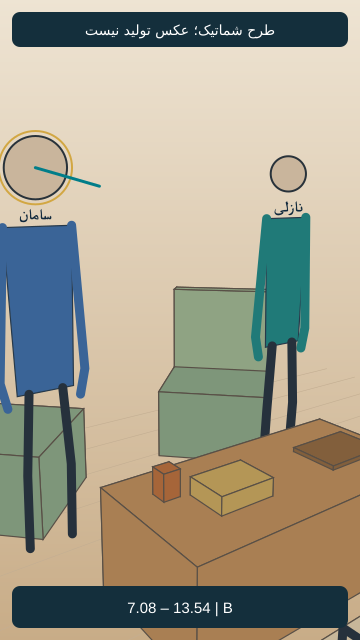
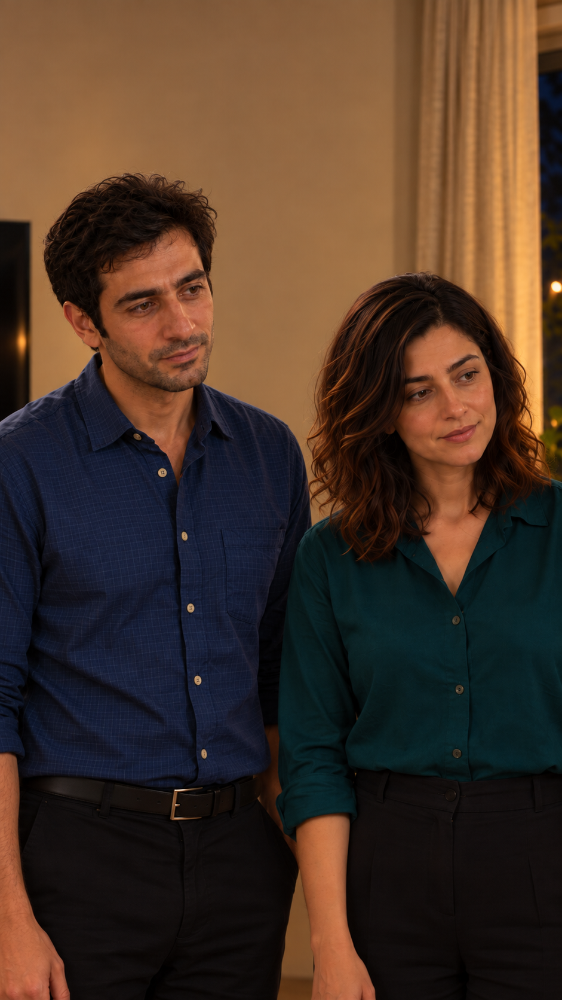
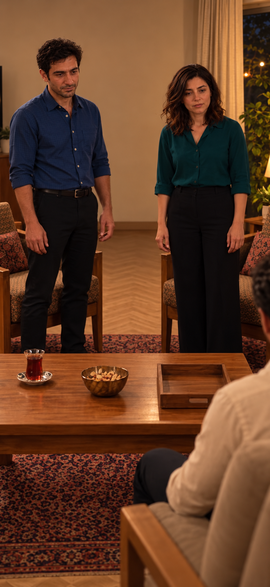
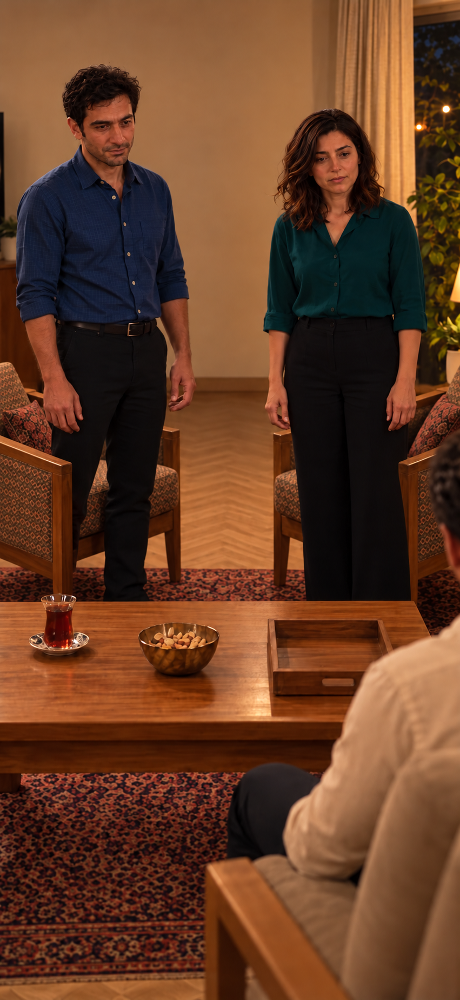

# EP05-SH05

## وضعیت فعلی

نسخهٔ ساندویچی با دعوت مشترک نازلی و مادرش به تأیید صریح کاربر رسید. اجرای واقعی نسخهٔ جدید بررسی نشده؛ هیچ مجوز ارسال تازه یا هزینه وجود ندارد.

<!-- shot-state -->
```json
{
  "shot": "EP05-SH05",
  "active": true,
  "order": 3,
  "selected_take": null,
  "selected_video": null,
  "selected_sha256": null,
  "selection_status": "not_selected",
  "selection_evidence": null,
  "trim": null,
  "active_frame": null,
  "send_request": null
}
```
<!-- /shot-state -->

## متن و دستور اجرا

[پیوستگی قسمت](../../continuity.md) · [قواعد پروژه](../../../../project-rules.md)

<a id="ep05-d05"></a>
### `EP05-D05` — سامان
- متن: «روزِ اَسباب‌کِشی کُمَکِشون کَردَم. نازْلی و مادَرِش گُفتَن شام مِهمونِ ما.»
- وضعیت متن: بازنویسی ساندویچی با تأیید صریح کاربر جایگزین شد؛ اجرای واقعی تأیید نشده.
- مالک گفتار: `CH-SAM`؛ مخاطب: جمع، سپس مادر و نازلی؛ گوینده داخل قاب، نوبت روشن و بدون هم‌پوشانی؛ شنونده‌ها ساکت و بدون لب‌خوانی گفتاری.
- دستور اجرا؛ خوانده نشود: خودمانی و ساده، برای توضیح آشنایی؛ نگاه به مادر و سپس نازلی. دعوت مشترک و شام جمعی است، نه بیرون‌رفتن دونفره.
- وضعیت جهت بازی: پیشنهادی در نسخهٔ پذیرفته‌شده؛ اجرای واقعی هنوز بررسی نشده.

## ضبط جاری دریافت‌شده

[فایل جاری کاربر](../../dialogs-input/02.m4a)؛ شماره‌گذاری تازه بر اساس ترتیب نسخهٔ ساندویچی است. تطبیق کلی ماشینی انجام شد؛ متن دقیق، لحن و تلفظ پذیرش شنیداری ندارند. مدت کامل 8.041 ثانیه؛ [ثبت بررسی جاری](../../dialogs-input/sandwich-review.md). فایل و زمان‌های قبلی چراغ، مرجع این نما نیستند.

## طرح قاب و بازی قسمت پنج — نسخهٔ۱، پیشنهادی

[](images/EP05-SH05-blocking-v1.svg)

- زمان پیشنهادی: 7.083 تا 13.542 ثانیه؛ مطابق برنامهٔ زمان، نه زمان خروجی تولیدشده.
- ایستگاه دوربین: کنار بیرونی فرهاد، رو به دو جوان ایستاده؛ مختصات و مخروط دید در [دادهٔ مشترک](../../references/shot-design-v1.json).
- انتظار پس‌زمینه: آشپزخانه پشت دوربین؛ دیوار جنوب، تلویزیون در چپ تصویر و پنجره در راست.
- حرکت و دلیل: ثابت؛ معرفی رابطهٔ فضایی
- ابتدا، کنش و پایان: سامان چپ تصویر و نازلی راست؛ هر دو جلوی صندلی خود ایستاده؛ سامان از فرهاد به مادر و نازلی نگاه می‌برد.
- وضعیت ظاهر: هویت از مرجع مصوب، لباس روزاول؛ تصویر شماتیک چهره ندارد و عکس نهایی هنوز ساخته نشده.
- [بررسی مستقل طراحی](design-review-v1.md) · [بستهٔ یک‌جای قاب‌ها](../../storyboard.html). این طرح ورودی تولید نیست؛ قاب فعال یا اجازهٔ ارسال عوض نشده است.

## قاب واقعی نسخهٔ۱ — نامزد مرور

[](images/EP05-SH05-start-v1.png)

- سامان چپ و نازلی راست ایستاده‌اند، هر دو رو به جمعِ نشسته در راستِ بیرون کادر؛ آشپزخانه پشت دوربین. قاب به متوسط دونفره محدود شد تا مبلمان ناسازگار دیده نشود.
- صورت سامان با پرتره مستقل و قاب نزدیک فعلی مقایسه و فرهای اضافه اصلاح شد؛ صورت نازلی با پنل هویت و قاب نزدیک تطبیق داده شد. پیراهن آبی شبکه‌ای و بلوز سبزآبی حفظ شدند.
- [گزارش مستقل فضا و ظاهر همین قاب](photo-review-v1.md)؛ تصویر در این نوبت واقعاً دیده شد.
- وضعیت: نامزد عکس پس از بررسی ثابت؛ مجوز تولید ویدیو نیست. تصویر فعلی در `active_frame` ننشسته و `send_request` همچنان خالی است. نسبت بومی عکس‌های تازه تقریباً۹:۱۶است؛ پیش از بستهٔ ارسال باید نسخهٔ دقیق۹:۱۶هم بررسی شود.


## اصلاح چیدمان میز — نسخهٔ۲، نامزد مرور

[](images/EP05-SH05-start-v2.png)

چای چپ، کاسه وسط و سینی خالی راست مطابق مرجع ارسالی قسمت۴؛ [گزارش نسخهٔ۲](photo-review-v2.md). اختلاف زاویهٔ صندلی‌ها با پلان هنوز باز است. نسخهٔ۱ همچنان برای واکنش بستهٔ پایان کاربرد دارد. مجوز ارسال و قاب فعال تغییر نکردند.


## اصلاح صندلی‌ها — نسخهٔ۳، نامزد مرور

[](images/EP05-SH05-start-v3.png)

[گزارش نسخهٔ۳](photo-review-v3.md) مرجع جاری مرور عکس است؛ جهت به داخل دیده و مقایسه شد، زاویهٔ عددی از این عکس اندازه‌گیری نشده. میز ثابت است و مجوز تولید تغییر نکرده.
