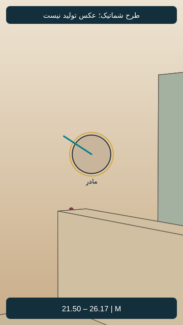
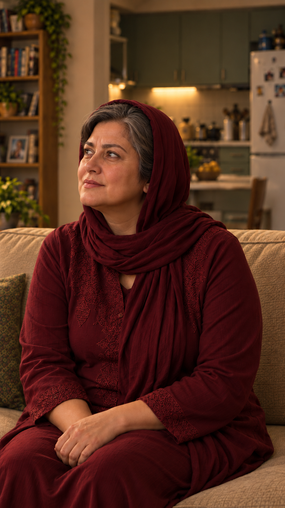

# EP05-SH08

## وضعیت فعلی

نسخهٔ ساندویچی با دعوت مشترک نازلی و مادرش به تأیید صریح کاربر رسید. اجرای واقعی نسخهٔ جدید بررسی نشده؛ هیچ مجوز ارسال تازه یا هزینه وجود ندارد.

<!-- shot-state -->
```json
{
  "shot": "EP05-SH08",
  "active": true,
  "order": 6,
  "selected_take": null,
  "selected_video": null,
  "selected_sha256": null,
  "selection_status": "not_selected",
  "selection_evidence": null,
  "trim": null,
  "active_frame": null,
  "send_request": null
}
```
<!-- /shot-state -->

## متن و دستور اجرا

[پیوستگی قسمت](../../continuity.md) · [قواعد پروژه](../../../../project-rules.md)

<a id="ep05-d08"></a>
### `EP05-D08` — مادر
- متن: «پَس چرا هَرچی می‌پُرسیدَم تُندِه، می‌گُفتی نَه؟»
- وضعیت متن: بازنویسی ساندویچی با تأیید صریح کاربر جایگزین شد؛ اجرای واقعی تأیید نشده.
- مالک گفتار: `CH-MNZ`؛ مخاطب: سامان؛ گوینده داخل قاب، نوبت روشن و بدون هم‌پوشانی؛ شنونده‌ها ساکت و بدون لب‌خوانی گفتاری.
- دستور اجرا؛ خوانده نشود: تازه متوجه علت رفتارش شده؛ تعجب همراه با لبخند، برای سربه‌سرگذاشتن سامان؛ بدون سرزنش یا بازجویی.
- وضعیت جهت بازی: پیشنهادی در نسخهٔ پذیرفته‌شده؛ اجرای واقعی هنوز بررسی نشده.

## ضبط جاری دریافت‌شده

[فایل جاری کاربر](../../dialogs-input/05.m4a)؛ شماره‌گذاری تازه بر اساس ترتیب نسخهٔ ساندویچی است. تطبیق کلی ماشینی انجام شد؛ متن دقیق، لحن و تلفظ پذیرش شنیداری ندارند. مدت کامل 5.396 ثانیه؛ [ثبت بررسی جاری](../../dialogs-input/sandwich-review.md). فایل و زمان‌های قبلی چراغ، مرجع این نما نیستند.

## طرح قاب و بازی قسمت پنج — نسخهٔ۱، پیشنهادی

[](images/EP05-SH08-blocking-v1.svg)

- زمان پیشنهادی: 21.500 تا 26.167 ثانیه؛ مطابق برنامهٔ زمان، نه زمان خروجی تولیدشده.
- ایستگاه دوربین: شرق و جنوب کاناپه، رو به مادر نشسته؛ مختصات و مخروط دید در [دادهٔ مشترک](../../references/shot-design-v1.json).
- انتظار پس‌زمینه: آشپزخانه پشت مادر؛ فرهاد در سمت ثابت دیگر کاناپه خارج برش است.
- حرکت و دلیل: ثابت
- ابتدا، کنش و پایان: مادر نشسته، نگاه بالا به چشم سامان؛ دست‌های خودش روی پا، روسری تک‌لایه و بدون حرکت نمایشی.
- وضعیت ظاهر: هویت از مرجع مصوب، لباس روزاول؛ تصویر شماتیک چهره ندارد و عکس نهایی هنوز ساخته نشده.
- [بررسی مستقل طراحی](design-review-v1.md) · [بستهٔ یک‌جای قاب‌ها](../../storyboard.html). این طرح ورودی تولید نیست؛ قاب فعال یا اجازهٔ ارسال عوض نشده است.

## قاب واقعی نسخهٔ۱ — نامزد مرور

[](images/EP05-SH08-start-v1.png)

- مادر روی نشیمن غربی کاناپه؛ سر و چشم‌ها واضح به بالا و چپ برای سامان ایستاده. آشپزخانه پشت مادر است؛ شانهٔ نازلیِ نشسته از مرجع قدیمی حذف شد.
- صورت و سن و بافت پوست و مو با پنل مادر مقایسه شد. یک روسری نرم زرشکی، موی واقعی جلوی پیشانی و شقیقه، بدون نوار صاف پوشش داخلی؛ تونیک اندازه و زرشکی. دست‌های خودش روی پای خودش، بدون دست اضافه.
- [گزارش مستقل فضا و ظاهر همین قاب](photo-review-v1.md)؛ تصویر در این نوبت واقعاً دیده شد.
- وضعیت: نامزد عکس پس از بررسی ثابت؛ مجوز تولید ویدیو نیست. تصویر فعلی در `active_frame` ننشسته و `send_request` همچنان خالی است. نسبت بومی عکس‌های تازه تقریباً۹:۱۶است؛ پیش از بستهٔ ارسال باید نسخهٔ دقیق۹:۱۶هم بررسی شود.


## بستهٔ پیشنهادی تولید — نسخهٔ۱

[پرامپت کامل](takes/take-01/prompt.txt) · [بررسی مستقل و موارد باز](takes/take-01/preflight.md) · [مرور بسته](../../production-review.html)

این آماده‌سازی مجوز ارسال نیست؛ قاب فعال، درخواست ارسال و برداشت منتخب تغییر نکرده‌اند.


## نسخهٔ دقیق ورودی — ۲۰۲۶/۱۰/۱۷

[عکس دقیق۹:۱۶](images/EP05-SH08-start-v1-input-9x16-v1.png)؛ بدون بزرگ‌نمایی، منبع و مختصات برش در [گزارش قالب](../../input-format-review-v1.md). این آماده‌سازی قاب فعال و مجوز ارسال را تغییر نمی‌دهد.
