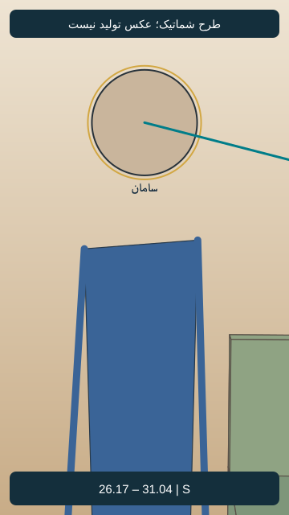
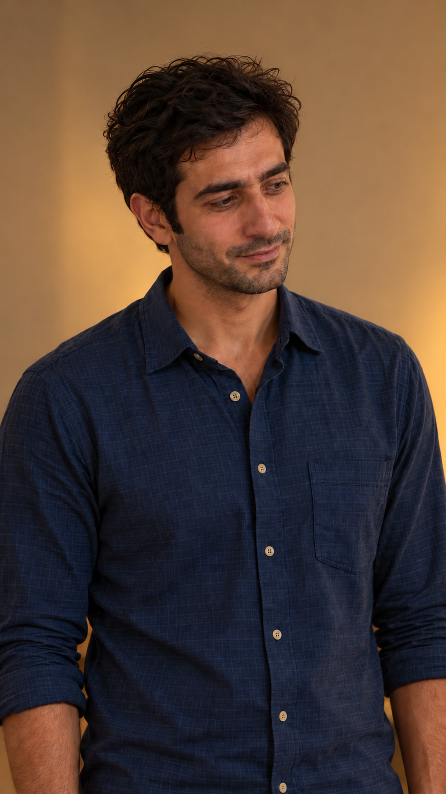

# EP05-SH10

## وضعیت فعلی

نسخهٔ ساندویچی با دعوت مشترک نازلی و مادرش به تأیید صریح کاربر رسید. اجرای واقعی نسخهٔ جدید بررسی نشده؛ هیچ مجوز ارسال تازه یا هزینه وجود ندارد.

<!-- shot-state -->
```json
{
  "shot": "EP05-SH10",
  "active": true,
  "order": 7,
  "selected_take": null,
  "selected_video": null,
  "selected_sha256": null,
  "selection_status": "not_selected",
  "selection_evidence": null,
  "trim": null,
  "active_frame": null,
  "send_request": null
}
```
<!-- /shot-state -->

## متن و دستور اجرا

[پیوستگی قسمت](../../continuity.md) · [قواعد پروژه](../../../../project-rules.md)

<a id="ep05-d10"></a>
### `EP05-D10` — سامان
- متن: «گُفتَم اوّلین شامی که مِهمونِتونَم، غُر نَزَنَم.»
- وضعیت متن: بازنویسی ساندویچی با تأیید صریح کاربر جایگزین شد؛ اجرای واقعی تأیید نشده.
- مالک گفتار: `CH-SAM`؛ مخاطب: مادر؛ گوینده داخل قاب، نوبت روشن و بدون هم‌پوشانی؛ شنونده‌ها ساکت و بدون لب‌خوانی گفتاری.
- دستور اجرا؛ خوانده نشود: مؤدب و کمی شوخ، برای توضیح رودربایستی آن شب؛ نگاه به مادر و لبخند مختصر.
- وضعیت جهت بازی: پیشنهادی در نسخهٔ پذیرفته‌شده؛ اجرای واقعی هنوز بررسی نشده.

پس از جمله، خندهٔ کوتاه و طبیعی نازلی و مادر پیشنهادی است؛ فرهاد بدون اخم یا مکث معنادار برای خداحافظی آماده شود. ریتم کش نیاید.

## ضبط جاری دریافت‌شده

[فایل جاری کاربر](../../dialogs-input/06.m4a)؛ شماره‌گذاری تازه بر اساس ترتیب نسخهٔ ساندویچی است. تطبیق کلی ماشینی انجام شد؛ متن دقیق، لحن و تلفظ پذیرش شنیداری ندارند. مدت کامل 5.908 ثانیه؛ [ثبت بررسی جاری](../../dialogs-input/sandwich-review.md). فایل و زمان‌های قبلی چراغ، مرجع این نما نیستند.

[بررسی دقیق‌تر فایل۰۶](../../dialogs-input/06-detail-review.md) و [برنامهٔ زمان](../../timing-plan.md): بازهٔ پیشنهادی۰٫۸۳۳۳تا۵٫۷۰۸۳ثانیه،۴٫۸۷۵ثانیه. تطبیق دقیق و لحن/تلفظ هنوز شنیداری تأیید نشده و برش اعمال نشده.

## طرح قاب و بازی قسمت پنج — نسخهٔ۱، پیشنهادی

[](images/EP05-SH10-blocking-v1.svg)

- زمان پیشنهادی: 26.167 تا 31.042 ثانیه؛ مطابق برنامهٔ زمان، نه زمان خروجی تولیدشده.
- ایستگاه دوربین: شرق سامان، نزدیک با ارتفاع چشم ایستاده؛ مختصات و مخروط دید در [دادهٔ مشترک](../../references/shot-design-v1.json).
- انتظار پس‌زمینه: دیوار جنوب؛ فقط لبهٔ تلویزیون شرق اگر در میدان واقعی جا شد؛ آشپزخانه پشت دوربین.
- حرکت و دلیل: ثابت؛ همان سوی محور نمای جواب سامان
- ابتدا، کنش و پایان: سامان مؤدبانه رو به مادر؛ پایان جمله لب‌ها بسته و لبخند کوتاه؛ سپس خندهٔ مادر و نازلی خارج قاب در همان دنباله.
- وضعیت ظاهر: هویت از مرجع مصوب، لباس روزاول؛ تصویر شماتیک چهره ندارد و عکس نهایی هنوز ساخته نشده.
- [بررسی مستقل طراحی](design-review-v1.md) · [بستهٔ یک‌جای قاب‌ها](../../storyboard.html). این طرح ورودی تولید نیست؛ قاب فعال یا اجازهٔ ارسال عوض نشده است.

دنبالهٔ۰٫۶۲۵ثانیه‌ای خنده در همین اندازه و زاویه ادامه دارد؛ مادر و نازلی خارج قاب‌اند، سامان لبخند کوتاه دارد و جملهٔ دیگری نمی‌گوید.

## قاب واقعی نسخهٔ۱ — نامزد مرور

[](../EP05-SH07/images/EP05-SH07-start-v1.png)

- همان قاب سامان از نمای۷؛ شروع نگاه راست و پایین برای مادر نشسته. تغییر مخاطب از نازلی به مادر باید با گردش کوچک چشم و سر و بدون جابه‌جایی پا اجرا شود.
- همان فایلِ قاب۷با همان اثرانگشت است؛ تغییر چهره و لباس از تعویض تصویر ایجاد نشده. حالت جواب کوتاه و لبخند طبیعی در قاب شروع دیده می‌شود.
- [گزارش مستقل فضا و ظاهر همین قاب](photo-review-v1.md)؛ تصویر در این نوبت واقعاً دیده شد.
- وضعیت: نامزد عکس پس از بررسی ثابت؛ مجوز تولید ویدیو نیست. تصویر فعلی در `active_frame` ننشسته و `send_request` همچنان خالی است. نسبت بومی عکس‌های تازه تقریباً۹:۱۶است؛ پیش از بستهٔ ارسال باید نسخهٔ دقیق۹:۱۶هم بررسی شود.
