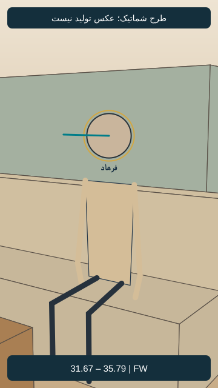

# EP05-SH14

## وضعیت فعلی

نسخهٔ ساندویچی با دعوت مشترک نازلی و مادرش به تأیید صریح کاربر رسید. اجرای واقعی نسخهٔ جدید بررسی نشده؛ هیچ مجوز ارسال تازه یا هزینه وجود ندارد.

<!-- shot-state -->
```json
{
  "shot": "EP05-SH14",
  "active": true,
  "order": 8,
  "selected_take": null,
  "selected_video": null,
  "selected_sha256": null,
  "selection_status": "not_selected",
  "selection_evidence": null,
  "trim": null,
  "active_frame": null,
  "send_request": null
}
```
<!-- /shot-state -->

## متن و دستور اجرا

[پیوستگی قسمت](../../continuity.md) · [قواعد پروژه](../../../../project-rules.md)

<a id="ep05-d14"></a>
### `EP05-D14` — فرهاد
- متن: «خِیلی هَم عالی. مَنَم کَم‌کَم مُرَخَّص بِشَم.»
- وضعیت متن: بازنویسی ساندویچی با تأیید صریح کاربر جایگزین شد؛ اجرای واقعی تأیید نشده.
- مالک گفتار: `CH-FAR`؛ مخاطب: جمع؛ گوینده داخل قاب، نوبت روشن و بدون هم‌پوشانی؛ شنونده‌ها ساکت و بدون لب‌خوانی گفتاری.
- دستور اجرا؛ خوانده نشود: مؤدب و معمولی برای پایان دیدار؛ بدون طعنه روی «عالی»؛ نگاه به جمع و آماده‌شدن آرام برای بلندشدن. مسیر خروج هنوز طراحی نشده است.
- وضعیت جهت بازی: پیشنهادی در نسخهٔ پذیرفته‌شده؛ اجرای واقعی هنوز بررسی نشده.

## ضبط جاری دریافت‌شده

[فایل جاری کاربر](../../dialogs-input/07.m4a)؛ شماره‌گذاری تازه بر اساس ترتیب نسخهٔ ساندویچی است. تطبیق کلی ماشینی انجام شد؛ متن دقیق، لحن و تلفظ پذیرش شنیداری ندارند. مدت کامل 5.055 ثانیه؛ [ثبت بررسی جاری](../../dialogs-input/sandwich-review.md). فایل و زمان‌های قبلی چراغ، مرجع این نما نیستند.

## طرح قاب و بازی قسمت پنج — نسخهٔ۱، پیشنهادی

[](images/EP05-SH14-blocking-v1.svg)

- زمان پیشنهادی: 31.667 تا 35.792 ثانیه؛ مطابق برنامهٔ زمان، نه زمان خروجی تولیدشده.
- ایستگاه دوربین: ایستگاه فرهاد، کمی بازتر برای آغاز بلندشدن؛ مختصات و مخروط دید در [دادهٔ مشترک](../../references/shot-design-v1.json).
- انتظار پس‌زمینه: کاناپه و آشپزخانه؛ دست‌ها روی ران خود فرهاد، هیچ دست همراه از خارج قاب.
- حرکت و دلیل: ثابت
- ابتدا، کنش و پایان: فرهاد ابتدا نشسته؛ نگاه به مادر و جمع؛ در پایان به جلو متمایل و شروع به بلندشدن می‌کند، بدون اخم. خروج کامل در این نما الزام ندارد.
- وضعیت ظاهر: هویت از مرجع مصوب، لباس روزاول؛ تصویر شماتیک چهره ندارد و عکس نهایی هنوز ساخته نشده.
- [بررسی مستقل طراحی](design-review-v1.md) · [بستهٔ یک‌جای قاب‌ها](../../storyboard.html). این طرح ورودی تولید نیست؛ قاب فعال یا اجازهٔ ارسال عوض نشده است.
