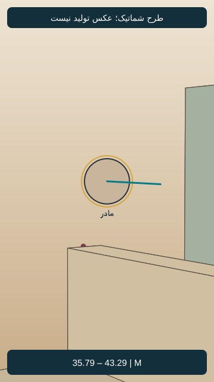
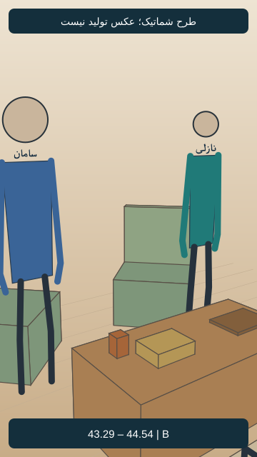

# EP05-SH15

## وضعیت فعلی

نسخهٔ ساندویچی با دعوت مشترک نازلی و مادرش به تأیید صریح کاربر رسید. اجرای واقعی نسخهٔ جدید بررسی نشده؛ هیچ مجوز ارسال تازه یا هزینه وجود ندارد.

<!-- shot-state -->
```json
{
  "shot": "EP05-SH15",
  "active": true,
  "order": 9,
  "selected_take": null,
  "selected_video": null,
  "selected_sha256": null,
  "selection_status": "not_selected",
  "selection_evidence": null,
  "trim": null,
  "active_frame": null,
  "send_request": null
}
```
<!-- /shot-state -->

## متن و دستور اجرا

[پیوستگی قسمت](../../continuity.md) · [قواعد پروژه](../../../../project-rules.md)

<a id="ep05-d15"></a>
### `EP05-D15` — مادر
- متن: «بُرو بِه سَلامَت، عَزیزَم. سامان، پَس با مادَرِت حَرْف بِزَن، بِبین فَردا می‌تونِه بیاد؟»
- وضعیت متن: بازنویسی ساندویچی با تأیید صریح کاربر جایگزین شد؛ اجرای واقعی تأیید نشده.
- مالک گفتار: `CH-MNZ`؛ مخاطب: فرهاد، سپس سامان؛ گوینده داخل قاب، نوبت روشن و بدون هم‌پوشانی؛ شنونده‌ها ساکت و بدون لب‌خوانی گفتاری.
- دستور اجرا؛ خوانده نشود: ابتدا بدرقهٔ گرم فرهاد، سپس تغییر نگاه به سامان و پیگیری طبیعی دعوت؛ قصد هماهنگی دیدار، بدون عجله در تغییر مخاطب.
- وضعیت جهت بازی: پیشنهادی در نسخهٔ پذیرفته‌شده؛ اجرای واقعی هنوز بررسی نشده.

پایان تصویری پیشنهادی: نازلی با شنیدن دعوت به سامان نگاه کند؛ نگرانی جای گرمی لحظهٔ قبل را بگیرد. سامان نگاهش را ببیند؛ قطع بدون دیالوگ اضافه.

## ضبط جاری دریافت‌شده

[فایل جاری کاربر](../../dialogs-input/08.m4a)؛ شماره‌گذاری تازه بر اساس ترتیب نسخهٔ ساندویچی است. تطبیق کلی ماشینی انجام شد؛ متن دقیق، لحن و تلفظ پذیرش شنیداری ندارند. مدت کامل 8.468 ثانیه؛ [ثبت بررسی جاری](../../dialogs-input/sandwich-review.md). فایل و زمان‌های قبلی چراغ، مرجع این نما نیستند.

## طرح قاب و بازی قسمت پنج — نسخهٔ۱، پیشنهادی

[](images/EP05-SH15-blocking-v1.svg)

- زمان پیشنهادی: 35.792 تا 43.292 ثانیه؛ مطابق برنامهٔ زمان، نه زمان خروجی تولیدشده.
- ایستگاه دوربین: شرق و جنوب کاناپه، رو به مادر نشسته؛ مختصات و مخروط دید در [دادهٔ مشترک](../../references/shot-design-v1.json).
- انتظار پس‌زمینه: آشپزخانه پشت مادر؛ فرهاد در سمت ثابت دیگر کاناپه خارج برش است.
- حرکت و دلیل: ثابت؛ تغییر مخاطب با سر و چشم
- ابتدا، کنش و پایان: مادر اول به فرهاد در حال بلندشدن، سپس به سامان نگاه کند. فرهاد از کنارهٔ شرقی میز به سمت راهرو برود؛ گذر از وسط میز و نشان‌دادن در ممنوع.
- وضعیت ظاهر: هویت از مرجع مصوب، لباس روزاول؛ تصویر شماتیک چهره ندارد و عکس نهایی هنوز ساخته نشده.
- [بررسی مستقل طراحی](design-review-v1.md) · [بستهٔ یک‌جای قاب‌ها](../../storyboard.html). این طرح ورودی تولید نیست؛ قاب فعال یا اجازهٔ ارسال عوض نشده است.

[](images/EP05-SH15-ending-blocking-v1.svg)

واکنش آخر از۴۳٫۲۹۲تا۴۴٫۵۴۲، همان جای بدن و صندلی‌ها؛ سامان چپ و نازلی راستِ تصویر.
