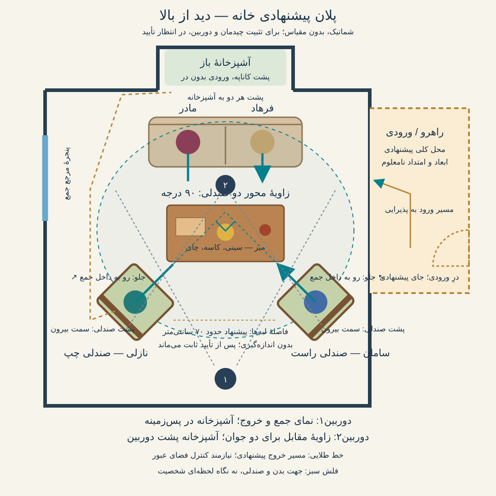

# مرجع مشترک خانهٔ سریال دامادِ یک‌شبه

این پوشه در ریشهٔ سریال، مالک واحد تصویر و پلان خانه برای **همهٔ قسمت‌ها** است. برای هر برداشت داخل خانه، تطبیق واقعی با همین مرجع و تعیین جای دوربین روی پلان الزامی است. تصویر تازه خودکار جایگزین این مرجع نمی‌شود؛ تغییر چیدمان باید با نسخه و تأیید روشن ثبت شود.

وضعیت۲۰۲۶/۱۰/۱۵: کاربر تصویر برش خانه را مبنای بازسازی قاب‌های قسمت۴ قرار داد. این تصویر مرجع چیدمان فعال است؛ اندازه‌ها و زاویه‌ها اندازه‌گیری نشده‌اند. [گالری بازسازی](../episodes/episode-04/frames.md).

# تصویر پیشنهادی خانه با سقف برداشته

[بررسی تصویر و محدودیت‌ها](cutaway-review.md) · [بازبینی دوبارهٔ قاب‌های قسمت۴](../episodes/episode-04/spatial-audit.md)

# پلان خانه، نسخهٔ۱ — پیشنهادی

این نقشه پلان اجرایی ساختمان یا اندازه‌برداری نیست. مبنا، تصویر جمع نمای۷ قسمت۳ و تصحیح صریح کاربر دربارهٔ زاویهٔ۹۰درجه است. آشپزخانه پشت کاناپهٔ مادر و فرهاد و پنجره سمت چپ مرجع جمع است. جای کلی راهرو از طرح اولیهٔ خانه گرفته شده؛ ابعاد، امتداد و ارتباط دقیق آن با پذیرایی هنوز قطعی نیست. اتاق‌های دیده‌نشده اختراع نشده‌اند.

- مادر و فرهاد روی کاناپه؛ پشتشان به آشپزخانه و رو به میز و جوان‌ها.
- نازلی جلو چپ و سامان جلو راست، صندلی‌ها رو به داخل چیدمان با زاویهٔ۹۰درجه نسبت به هم. نگاه می‌تواند بچرخد؛ جای صندلی تغییر نمی‌کند.
- فاصلهٔ پیشنهادی حدود۷۰سانتی‌متر میان نزدیک‌ترین لبه‌های صندلی‌هاست، نه فاصلهٔ مرکز بدن‌ها. این عدد هنوز مصوب یا اندازه‌گیری‌شده نیست؛ کاربر بازهٔ۷۰سانتی‌متر تا یک متر را مثال زد.
- دوربین۱ سمت پشت/کنار دو صندلی: کاناپه و آشپزخانه در عمق؛ صورت جوان‌ها می‌تواند نیم‌رخ یا پوشیده باشد.
- دوربین۲ سمت کاناپه و رو به جوان‌ها: آشپزخانه پشت دوربین است و نباید در پس‌زمینهٔ جوان‌ها بازتولید شود. محل دقیق دوربین و خط نگاه برای هر نما پس از پذیرش نقشه مشخص می‌شود.
- خط طلایی فقط مسیر پیشنهادی رفتن از بیرون چپ میز است؛ عرض گذرگاه و عبور سامان هنوز اثبات نشده‌اند.

قاب‌های اصلاحی آخر که پشت جوان‌ها آشپزخانه نشان می‌دهند مردودند و وارد دارایی فعال پروژه نشده‌اند. قاب۴ و قاب خروج قبلی هم به‌علت هندسهٔ ناسازگار از قاب فعال کنار گذاشته شدند؛ تأیید قبلی شامل این ایراد کشف‌شده نیست. تولید قاب بعدی تا تثبیت نقشه متوقف است. داستان و دیالوگ تغییر نکرده‌اند.

## توضیح جهت صندلی‌ها و ورودی

در نسخهٔ خواناتر، خط ضخیم پشت صندلی و فلش سبز جلوی آن را مشخص می‌کنند؛ هر دو صندلی رو به محدودهٔ گفتگو و داخل چیدمان‌اند، نه رو به آشپزخانه یا بیرون جمع. جهت نگاه به مادر، فرهاد یا سامان می‌تواند با چرخش سر تغییر کند؛ صندلی برای عوض‌شدن مخاطب نمی‌چرخد. زاویه۹۰درجه میان محور صندلی‌ها قید کاربر است؛ زاویهٔ دقیق هر صندلی نسبت به کاناپه در این پلان هنوز پیشنهادی است.

در و مسیر ورود در امتداد راهروی خط‌چین واضح‌تر شدند. این محل در، پیشنهاد طراحی است و از عکس‌ها اندازه‌گیری یا قطعی نشده؛ نشانهٔ در روی نقشه نباید به تولید خودکار معماری تازه تعبیر شود. بخش‌های دیده‌نشدهٔ آپارتمان پس از تعیین جای واقعی طراحی می‌شوند.

بازبینی قبلی عکس‌ها برای کنترل هندسه کافی نبود؛ خروجی‌های آخر تأیید هندسی ندارند. تا پذیرش پلان، تولید عکس ادامه پیدا نمی‌کند.
