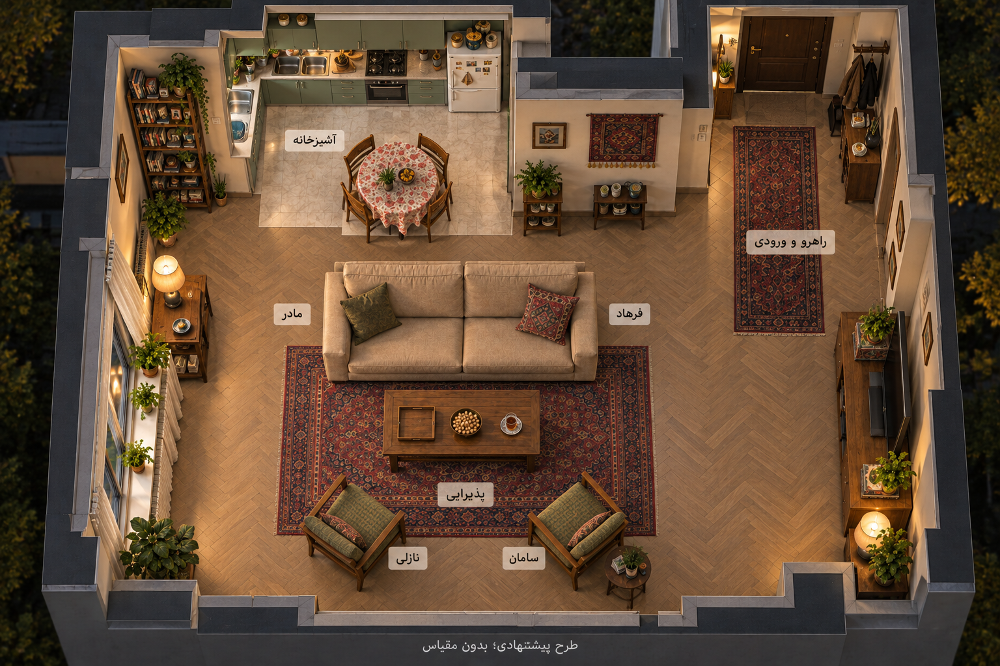

# تصویر مرجع برش خانه — پیشنهادی

این تصویر با ابزار داخلی ساخته و پس از یک اصلاح زاویه دیده شد. سقف برداشته و آشپزخانه، کاناپه، میز، دو صندلی، پنجره، تلویزیون و راهروی ورودی خوانا هستند. کاناپه پشت به آشپزخانه است؛ دو صندلی پایین تصویر به داخل جمع متمایل‌اند و چیدمان موازی ردشده تکرار نشده است. برچسب مادر چپ و فرهاد راست کاناپه، نازلی چپ و سامان راست صندلی‌هاست.

**محدودیت واقعی:** دید هنوز از بالای مایل است، نه تصویر قائم و بدون پرسپکتیو. رابطهٔ فضایی قابل‌خواندن است ولی زاویه۹۰درجه و فاصله۷۰سانتی‌متر اندازه‌گیری نشده‌اند. جزئیات کابینت، سینک و میز غذاخوری و اندازهٔ راهرو بازسازی پیشنهادی‌اند؛ تمام جزئیات منبع تاریخی را عیناً اثبات نمی‌کنند. اتاق خواب و حمام که شاهد نداریم طراحی نشده‌اند. این تصویر با درخواست کاربر مبنای چیدمان بازسازی قسمت۴ شد؛ اندازه‌گیری واقعی ساختمان نیست. نقشهٔ شماتیک همچنان ابزار کنترل دقیق جهت‌هاست و تصویر مولد جای آن را نمی‌گیرد.

[پرامپت اولیه](apartment-cutaway-initial-prompt.txt) · [اصلاح زاویه](apartment-cutaway-edit-prompt.txt) · [ثبت ورودی و خروجی](apartment-cutaway-v2.json)
